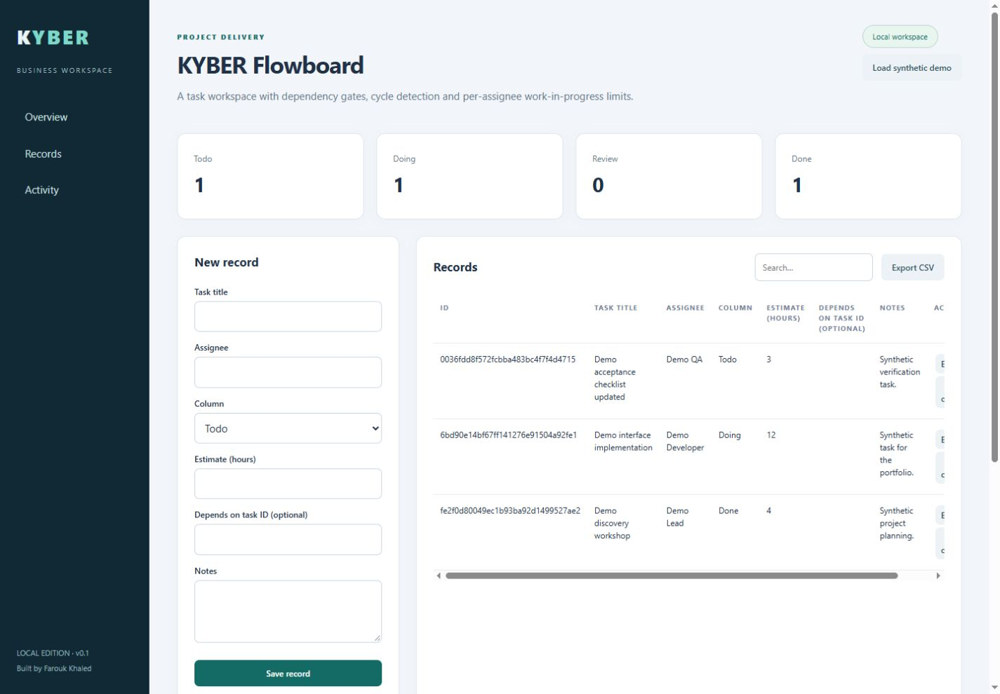

# KYBER Flowboard

A task workspace with dependency gates, cycle detection and per-assignee work-in-progress limits.



**Status: v0.1 portfolio implementation.** Created by Farouk Khaled for the KYBER portfolio. This is new work created in November 2026, not a historical client deployment.

## Features

- Forms, search, CSV export and activity history.
- Locked JSON storage with atomic file replacement.
- Dependency cycle detection and blocked-task validation.
- WIP limit of three Doing tasks per assignee.

## Technology

PHP 8.2+, JavaScript, HTML and CSS. No third-party runtime dependencies.

## Run

```sh
php -S 127.0.0.1:3000 index.php
# Open http://127.0.0.1:3000
```

## Verify

```sh
php tests.php
```

See [VALIDATION.md](VALIDATION.md) for the checks actually run in the authoring environment.

## Scope and limitations

- Single-user local edition without authentication. Do not expose to the internet.
- PHP development server only; no production deployment configuration.
- No third-party integrations or team permissions.

## Repository layout

Source, configuration, synthetic sample data and tests are kept in this repository. Runtime databases and generated reports are ignored. Never commit client data, credentials or unredacted reports.

## Roadmap

- Broaden test fixtures and error recovery coverage.
- Gather real usability feedback using synthetic data.
- Version the data format before adding import/migration features.

## Security

Report concerns privately through the contact options on [the maintainer profile](https://github.com/faroukkhaled). Do not include secrets in public issues. See [SECURITY.md](SECURITY.md).

## License

No license has been granted yet. Contact the author before reuse or redistribution.

## Demo data

Use **Load synthetic demo** in an empty workspace to create fictional examples. All email addresses use the reserved example.test domain. No real client data is included.
